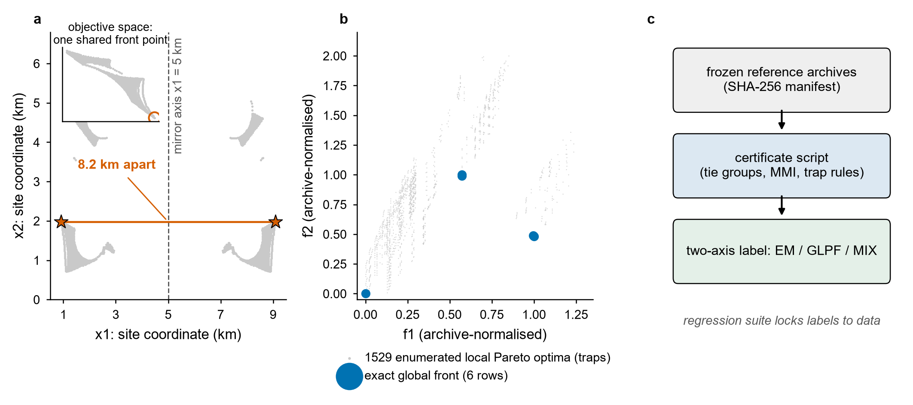
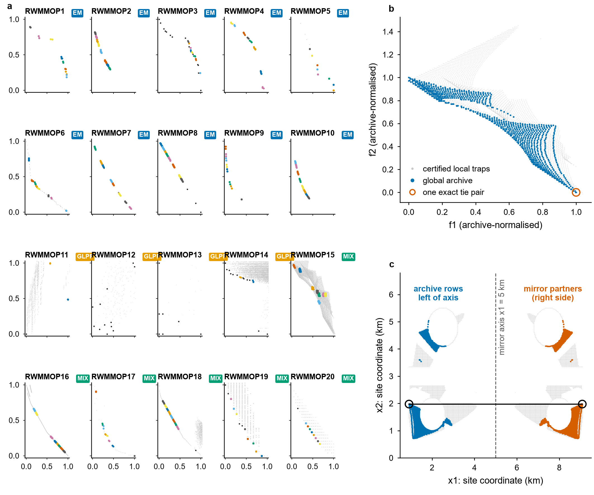
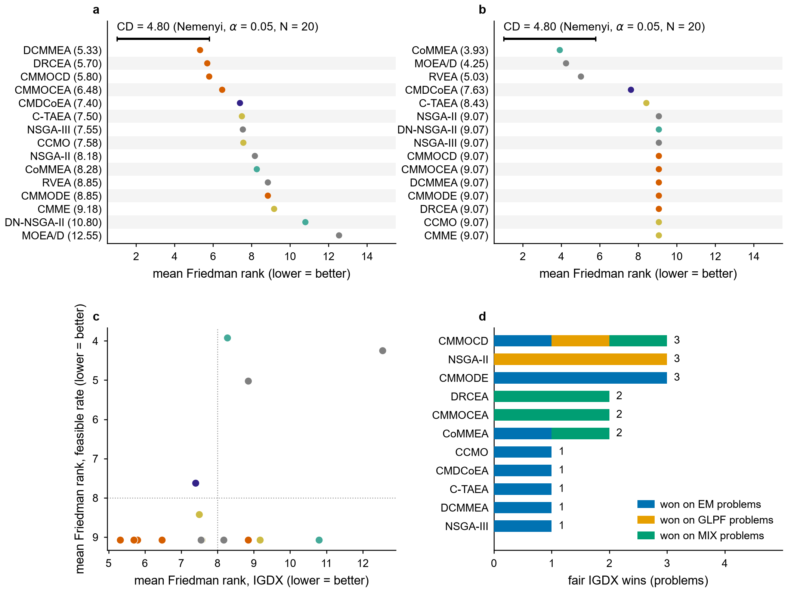
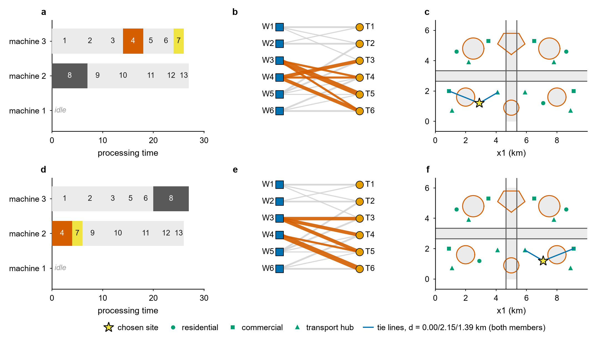
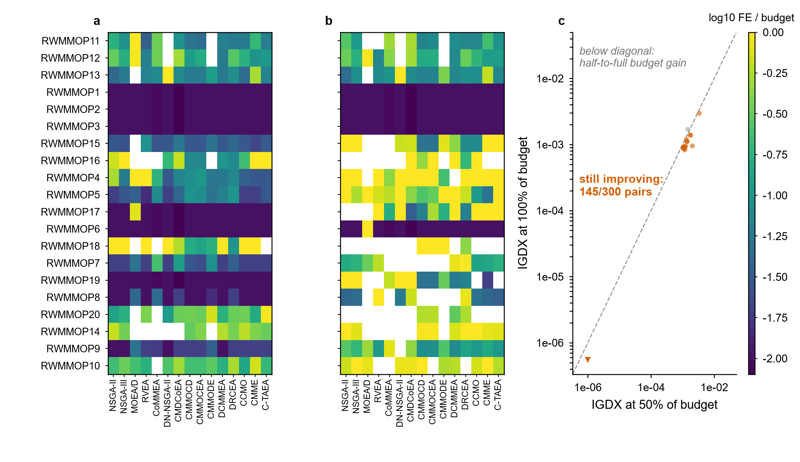
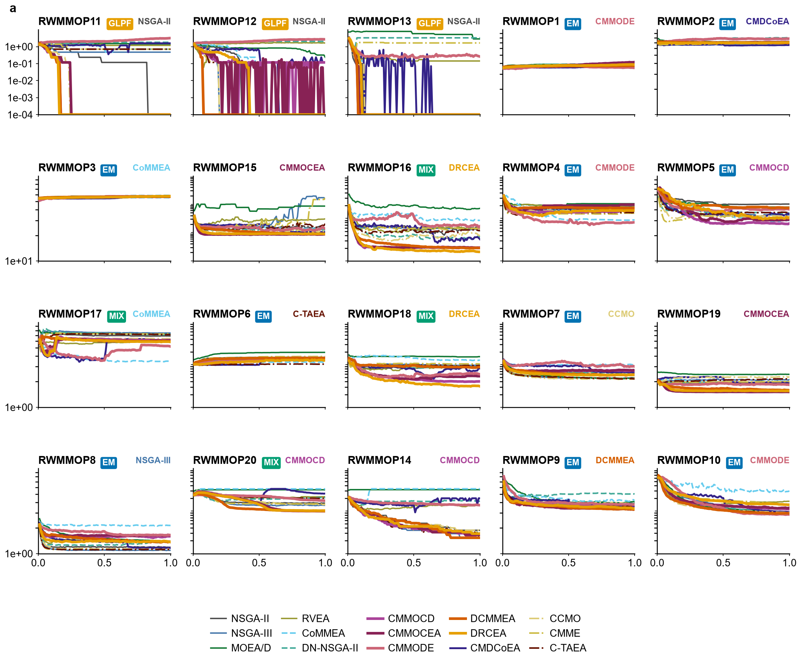
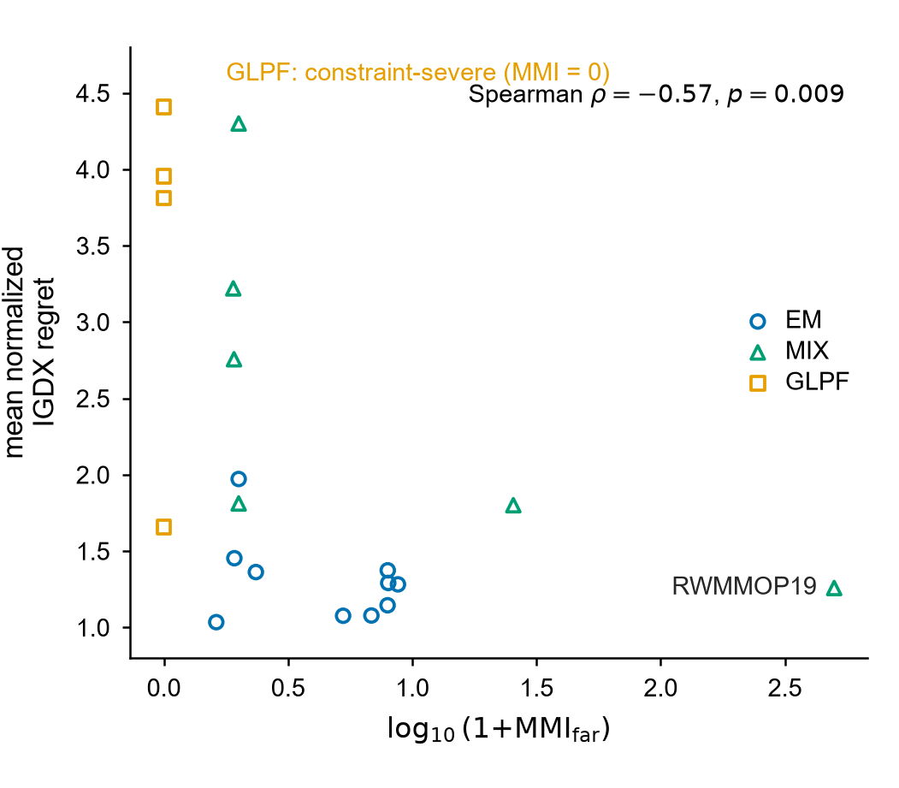
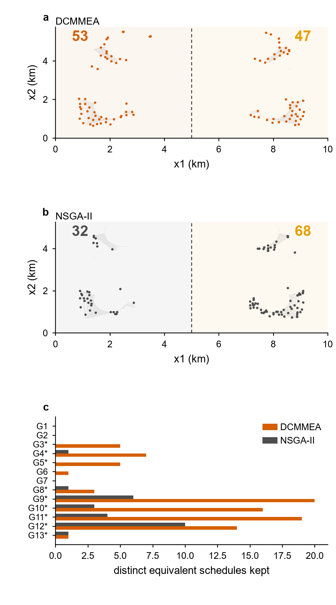
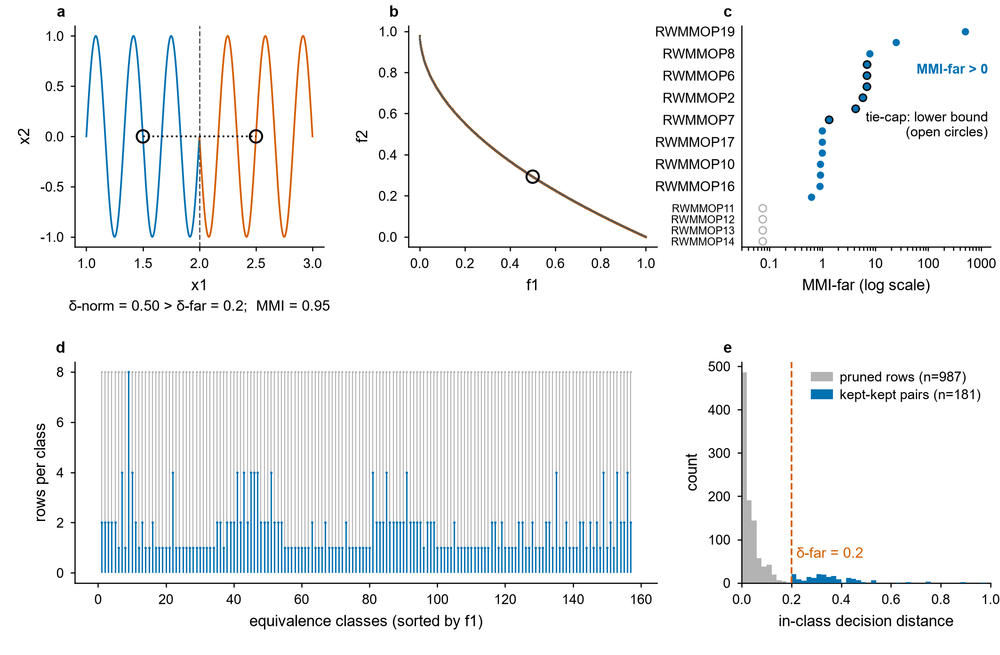

# RWMMO: Real-World Problems for Multimodal Multi-Objective Optimization

RWMMO is a benchmark of **20 real-world multimodal multi-objective optimization problems**, implemented as drop-in [PlatEMO](https://github.com/BIMK/PlatEMO) problem classes and shipped with **certified reference solution sets** (reference Pareto fronts and Pareto sets, plus local-front certificates). It is designed to measure the two faces of multimodality separately:

- **Equivalent solutions (EM)** — distinct decision vectors whose objective vectors are *bit-identical* (exact tie groups of optima);
- **Local Pareto traps (GLPF)** — solutions that are locally, but not globally, Pareto optimal.

Repository: <https://github.com/Wenhua-Li/RWMMOP>

## Key results

The main evaluation runs **20 problems x 15 algorithms x 10 seeds = 3,000 runs** (population size 100, per-problem budget `maxFE(D) = min(max(5000*D, 20000), 50000)`). The full protocol and statistical analysis are in the paper and its supplementary material (`docs/RWMMO_supplementary.pdf`).

| The two phenomena named "multimodal" | Certified fronts and the two-axis certificate |
|:---:|:---:|
|  |  |

*Left:* the two phenomena that share the name "multimodal", shown on two problems (a mirror-image facility pair with bit-identical objectives on RWMMOP15; the exact global front in front of 1529 enumerated local traps on RWMMOP11) and the certificate pipeline that labels every problem. *Right:* the 20 published reference fronts (one panel per problem, modality badge per problem); same-colour markers connect members of an exact tie group — decision-distinct solutions with bit-identical objective vectors; the right column certifies both modality axes on RWMMOP15 (958 mirror tie pairs, up to 8.2 km apart, in front of the published local-trap certificate).

| The two-axis split | Identical objectives, materially different designs |
|:---:|:---:|
|  |  |

*Left:* Friedman mean ranks with Nemenyi critical difference on the two claim-carrying axes (IGDX and feasible rate), a rank-rank scatter showing that no algorithm wins both axes, and fair IGDX wins stacked by problem modality label. *Right:* two members of one exact tie group in each of three encoding families — RWMMOP19 parallel-machine Gantt charts, RWMMOP9 weapon-target allocations, RWMMOP15 mirror-image facility sites; objectives are bit-identical within each pair.

| Budget honesty | Convergence grid |
|:---:|:---:|
|  |  |

*Left:* median first-hit evaluation fraction under two quality thresholds (white = never hit in budget) and IGDX at 50% versus 100% of budget per problem-algorithm pair (145/300 pairs still improve at full budget). *Right:* median IGDX convergence curves of the whole panel (one colour per algorithm; each panel names its best algorithm; exact zeros clip to the visual floor).

| Modality vs. difficulty | Case study |
|:---:|:---:|
|  |  |

*Left:* certified modality strength does not increase the panel's relative regret (Spearman rho = -0.57); the constraint-severe GLPF group carries the heavy regrets. *Right:* the mechanism on two problems: objective convergence is not decision coverage (91 vs 26 distinct equivalent schedules kept on RWMMOP19; mirror-side balance 53/47 vs 32/68 on RWMMOP15).

| Certification machinery |
|:---:|
|  |

*How modality strength is certified: MMI calibrated on standard multimodal problems (a, b), the per-problem certified strengths (c), the fixed-point mode filter collapsing near-duplicate branches (d), and the decision-distance separation it enforces (e); grey = raw archive, blue = published.*

## Problem suite

| ID | Problem class | Domain | Encoding | D | M | Reference level | Modality | PF rows | Exact tie groups | Max mult. | MMI_far |
|---|---|---|---|---|---|---|---|---|---|---|---|
RWMMOP11 | `RWMMOP11_DNR69` | distribution network reconfiguration | binary | 73 | 3 | exact | GLPF | 6 | 0 | 1 | 0.000 |
RWMMOP2 | `RWMMOP2_Jobshop5` | job shop scheduling | permutation/integer | 36 | 2 | high-budget-approx | EM | 1041 | 163 | 8 | 5.844 |
RWMMOP12 | `RWMMOP12_DNR33MS` | distribution network reconfiguration under peak stress | binary | 37 | 3 | exact | GLPF | 12 | 0 | 1 | 0.000 |
RWMMOP13 | `RWMMOP13_DNR33MP` | distribution network reconfiguration, two periods | integer | 2 | 3 | exact | GLPF | 7 | 0 | 1 | 0.000 |
RWMMOP1 | `RWMMOP1_SatelliteTTC25` | satellite scheduling | integer | 164 | 2 | high-budget-approx | EM | 181 | 35 | 8 | 4.265 |
RWMMOP3 | `RWMMOP3_SatelliteTTC50` | satellite scheduling | integer | 352 | 2 | high-budget-approx | EM | 48 | 3 | 4 | 0.625 |
RWMMOP15 | `RWMMOP15_SiteSelect` | emergency facility location | real | 2 | 3 | certified-dense | MIX | 1916 | 958 | 2 | 1.000 |
RWMMOP16 | `RWMMOP16_BlendPool` | feed-stock pooling and blending | real | 3 | 2 | certified-dense | MIX | 849 | 223 | 3 | 0.902 |
RWMMOP4 | `RWMMOP4_ArrayNull` | antenna array pattern synthesis | real | 8 | 2 | high-budget-approx | EM | 148 | 74 | 2 | 1.000 |
RWMMOP5 | `RWMMOP5_WindFarm` | wind farm layout | real | 16 | 2 | high-budget-approx | EM | 104 | 13 | 8 | 7.000 |
RWMMOP17 | `RWMMOP17_HomotopyPath` | robot path planning | real | 12 | 2 | homotopy-certified | MIX | 64 | 32 | 2 | 1.000 |
RWMMOP6 | `RWMMOP6_NestingLayout` | cutting stock / nesting | real | 18 | 2 | high-budget-approx | EM | 452 | 57 | 8 | 6.965 |
RWMMOP18 | `RWMMOP18_ReservoirOps` | reservoir operation | real | 8 | 2 | high-budget-approx | MIX | 284 | 130 | 2 | 0.915 |
RWMMOP7 | `RWMMOP7_EcoDispatch15MF` | combined economic-emission dispatch | real | 15 | 2 | high-budget-approx | EM | 269 | 74 | 8 | 1.346 |
RWMMOP19 | `RWMMOP19_PMSched13` | parallel machine scheduling | integer | 13 | 2 | exact | MIX | 1661 | 9 | 770 | 498.212 |
RWMMOP8 | `RWMMOP8_Knapsack24` | 0/1 knapsack (resource selection) | binary | 24 | 2 | exact | EM | 924 | 147 | 27 | 7.755 |
RWMMOP20 | `RWMMOP20_BiTree12` | network design (spanning tree) | binary | 24 | 2 | exact | MIX | 321 | 18 | 41 | 24.511 |
RWMMOP14 | `RWMMOP14_Net12Sparse` | microgrid topology | binary | 21 | 2 | exact | GLPF | 17 | 0 | 1 | 0.000 |
RWMMOP9 | `RWMMOP9_WTA66` | defence resource allocation | integer | 36 | 2 | high-budget-approx | EM | 258 | 33 | 8 | 6.953 |
RWMMOP10 | `RWMMOP10_Truss25` | structural sizing | real | 25 | 2 | high-budget-approx | EM | 295 | 136 | 2 | 0.922 |

**Reference level** — how strong the certificate behind the shipped archive is:

- `exact`: the design space is fully enumerable; the archive *is* the global Pareto set, cross-checked by a second independent method;
- `certified-dense`: feasibility is decided analytically at every grid node and each objective is 1-Lipschitz, so the eps-dense archive carries a recorded Hausdorff bound;
- `homotopy-certified`: the homotopy (obstacle side-sign) classes are enumerated explicitly and the archive is the nondominated union of the per-class fronts;
- `high-budget-approx`: a fixed-point archive of a high-budget reference search; metrics measured against it are optimistic lower bounds and are labelled as such in the paper.

**Modality** — `EM`: exact equivalent optima exist (tie groups); `GLPF`: multimodality appears as locally-Pareto-optimal traps, with no equivalent optima in the global archive; `MIX`: both.

**PF rows / Exact tie groups / Max mult.** — rows in the published global reference archive, the number of archived exact objective-tie groups, and the largest multiplicity within one tie group. **MMI_far** — the mean number of additional *far-apart* (at least 0.2 of the decision range) equivalent branches per reference-front point; 0.000 means the problem's multimodality lives on the local-trap axis only.

## Installation

Requirements: MATLAB **R2020b or newer** (this release was validated on R2025b) and [PlatEMO](https://github.com/BIMK/PlatEMO) **v4.x** (validated with v4.16).

1. Download PlatEMO and unpack it anywhere, e.g. `C:/PlatEMO`.
2. Either copy this repository's `Problems/RWMMO` folder into `<PlatEMO>/Problems/Multi-objective optimization/`, or keep the repository anywhere and add it to the MATLAB path (step 3 handles both).
3. Run the quickstart:

```matlab
edit('examples/quickstart.m')   % set PLATEMO_ROOT to your PlatEMO folder, then run
```

The quickstart instantiates three showcase problems, evaluates random initial populations, prints feasibility statistics, and saves a figure comparing the samples with the reference Pareto front of each problem.

## Usage

Every problem is a standard PlatEMO `PROBLEM` class, so the whole PlatEMO toolchain (algorithms, metrics, GUI) works unchanged:

```matlab
addpath(genpath('C:/PlatEMO'));                        % PlatEMO (once)
addpath(genpath('<repo>/Problems'));                   % RWMMO problems (added after PlatEMO)

pro = RWMMOP8_Knapsack24('N',100,'maxFE',20000);         % problem object (loads frozen data + reference archive)
P   = pro.Initialization(100);                         % 100 initial solutions (SOLUTION objects)
P.objs; P.cons;                                        % objectives (normalised) and constraint violations
pro.GetPF(); pro.GetPS();                              % reference Pareto front / set

% run any PlatEMO algorithm on any RWMMO problem:
[PopDec,PopObj,PopCon] = platemo('algorithm',@NSGAII, ...
    'problem',@RWMMOP11_DNR69,'N',100,'maxFE',50000);
```

Domain-specific solution rendering is available per problem, e.g. `pro.DrawSolution(dec)`.

## Reference solution sets

All reference material ships in `Problems/RWMMO/ref_pf_ps/`:

- **Global archives** `RWMMO_<Problem>_reference.mat` (satellite problems: `*_full_reference.mat`) with variables `PS_ref` (reference decision rows), `PF_ref` (normalised objective rows), `PF_ref_raw` (raw objectives) and `objLo`/`objHi` (frozen normalisation constants). These back `GetPF`/`GetPS`/`CalMetric` (IGDX is computed against `PS_ref`).
- **Local-front certificates** `RWMMO_<Problem>_local_reference.mat` with `PS_local`/`PF_local`/`PF_local_raw`: locally-but-not-globally Pareto-optimal solutions that pass a published quality gate — the evidence behind GLPF claims.
- **Provenance sidecars** `*_metadata.txt` recording how each archive was built.

Integrity: `CHECKSUMS.txt` lists the SHA-256 of every file in this repository (verify with `sha256sum -c CHECKSUMS.txt` on Linux/macOS or `certutil -hashfile <file> SHA256` on Windows).

## Repository layout

```
README.md                       this file
LICENSE                         MIT
CHECKSUMS.txt                   SHA-256 of every shipped file
Problems/RWMMO/                 20 problem classes + utils/ + viz/ + data/ + ref_pf_ps/
examples/quickstart.m           one-click installation check
figures/                        result figures used above (all 9 main-text figures, 2026-10-05 v2 redesign)
docs/RWMMO_supplementary.pdf    supplementary material of the paper
```

## Supplementary material

`docs/RWMMO_supplementary.pdf` contains the supplementary material of the RWMMO paper (36 pages): per-problem profiles (S1), the equivalent-design showcase — two equally optimal, materially different solutions for every problem (S2), reference-archive documentation (S3), the per-problem licence and provenance audit (S4), independent oracle checks (S5), full statistical tables (S6), trajectory grids and gallery indices (S7), MMI robustness (S8) and reproduction instructions (S9).

## License

This repository (problem implementations, frozen data snapshots, reference solution sets, figures, documentation) is released under the **MIT License** — see `LICENSE`.

Every problem's data provenance was audited before acceptance: public standard test-feeder data (IEEE 33/69-bus), classical public-domain model families with original instances and implementations, or fully self-constructed instances; the audit trail is summarized in the supplementary material (S4). **Five third-party algorithm ports compared in the paper are not redistributed in this repository** pending licence confirmation by their authors; their sources and reproduction routes are documented in the supplementary material (S4/S9).

## Citation

```bibtex
@misc{rwmmo2026,
  title  = {RWMMO: A Real-World Benchmark for Multimodal Multi-Objective Optimization},
  author = {Li, Wenhua and Wang, Rui and Zhang, Tao and Lu, Xin},
  year   = {2026},
  note   = {Preprint; citation to be updated upon publication},
  url    = {https://github.com/Wenhua-Li/RWMMOP}
}
```

## Contact

Issues and pull requests: <https://github.com/Wenhua-Li/RWMMOP>.
